<p align="center">
  <a href="https://paidmcp.dev">
    
  </a>
</p>

<p align="center">
  <a href="https://paidmcp.dev"></a>
  &nbsp;
  <a href="https://paidmcp.dev/connect"></a>
  &nbsp;
  <a href="https://github.com/paidmcp/template"></a>
</p>

<p align="center">
  Build native MCP + x402 servers that AI agents connect to directly,<br>
  with a free testnet onboarding path and pay-per-call stablecoin settlement.
</p>


## How it works

<p align="center">
  
</p>

Every paid call is a normal MCP tool call with a price attached. No accounts, no API keys to hand out, no invoices: the agent pays for what it uses, when it uses it.

## Repositories

<p align="center">
  <a href="https://github.com/paidmcp/template"></a>
  <a href="https://github.com/paidmcp/client"></a>
</p>
<p align="center">
  <a href="https://github.com/paidmcp/examples"></a>
  <a href="https://github.com/paidmcp/directory"></a>
</p>

## Quick start

<p align="center">
  
  
</p>

<details open>
<summary><b>For users</b>: connect an agent to paid MCP servers</summary>
<br>

**Managed wallet flow (recommended)**

```bash
npx paidmcp-client init
```

```bash
npx paidmcp-client wallet
```

Then connect using the snippets on [paidmcp.dev/connect](https://paidmcp.dev/connect).

**Native flow (no proxy)**

Point your MCP client directly at a server's `/mcp` endpoint.

Start on testnet first, then move to live stablecoins when you are ready.

</details>

<details>
<summary><b>For builders</b>: ship a server that gets paid</summary>
<br>

1. Fork [`template`](https://github.com/paidmcp/template).
2. Create a wallet and testnet-ready env defaults:

   ```bash
   npm run setup
   ```

3. Edit `src/tools.ts`, deploy, and submit your server to the [directory](https://paidmcp.dev) with pricing.

</details>

Full onboarding lives in the README of [`client`](https://github.com/paidmcp/client), [`template`](https://github.com/paidmcp/template), and [`examples`](https://github.com/paidmcp/examples).

## Community

| | |
| :-- | :-- |
| **Contributing** | See `CONTRIBUTING.md` in each repository |
| **Security** | Report through `SECURITY.md` in the affected repository |
| **Conduct** | See `CODE_OF_CONDUCT.md` in each repository |
| **License** | MIT in every repository |


<p align="center">
  <a href="https://paidmcp.dev"></a>
  <br>
  <sub><a href="https://paidmcp.dev">paidmcp.dev</a> · native MCP + x402 · pay-per-call · testnet first</sub>
</p>
