<p align="center">
  <a href="https://paidmcp.dev">
    
  </a>
</p>

<p align="center">
  <a href="https://paidmcp.dev"></a>
  &nbsp;
  <a href="https://paidmcp.dev/connect"></a>
  &nbsp;
  <a href="https://github.com/paidmcp/template"></a>
</p>

<p align="center">
  Open infrastructure for monetizable MCP servers.<br>
  Build native MCP + x402 servers that AI agents connect to directly,<br>
  with a free testnet onboarding path and pay-per-call stablecoin settlement.
</p>

<br>


<p align="center">
  
</p>

<br>


<p align="center">
  <a href="https://github.com/paidmcp/template"></a>
  <a href="https://github.com/paidmcp/client"></a>
  <a href="https://github.com/paidmcp/examples"></a>
  <a href="https://github.com/paidmcp/directory"></a>
</p>

<br>


<p align="center">
  
  
</p>

<details>
<summary><b>Users</b>: copyable steps</summary>
<br>

**Managed wallet flow (recommended)**

```bash
npx paidmcp-client init
```

```bash
npx paidmcp-client wallet
```

Then connect using the snippets on [paidmcp.dev/connect](https://paidmcp.dev/connect).

**Native flow (no proxy)**

Point your MCP client directly at a server's `/mcp` endpoint.

Start on testnet first, then move to live stablecoins when you are ready.

</details>

<details>
<summary><b>Builders</b>: copyable steps</summary>
<br>

1. Fork [`template`](https://github.com/paidmcp/template).
2. Create a wallet and testnet-ready env defaults:

   ```bash
   npm run setup
   ```

3. Edit `src/tools.ts`, deploy, and submit your server to the [directory](https://paidmcp.dev) with pricing.

</details>

<br>

<p align="center">
  <a href="https://paidmcp.dev"></a>
</p>
<p align="center">
  <sub>
    <a href="https://paidmcp.dev">paidmcp.dev</a> ·
    Contributing, security and conduct notes live in each repository ·
    MIT licensed
  </sub>
</p>
